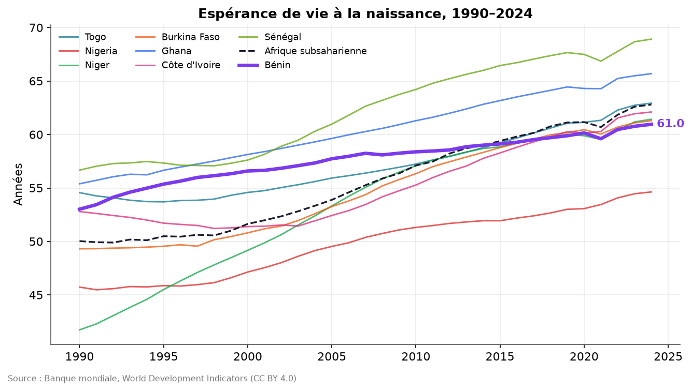
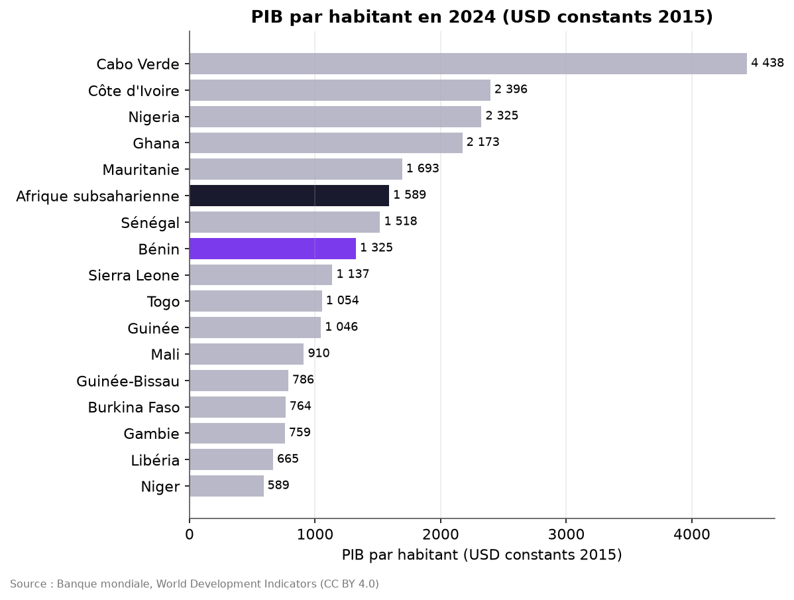
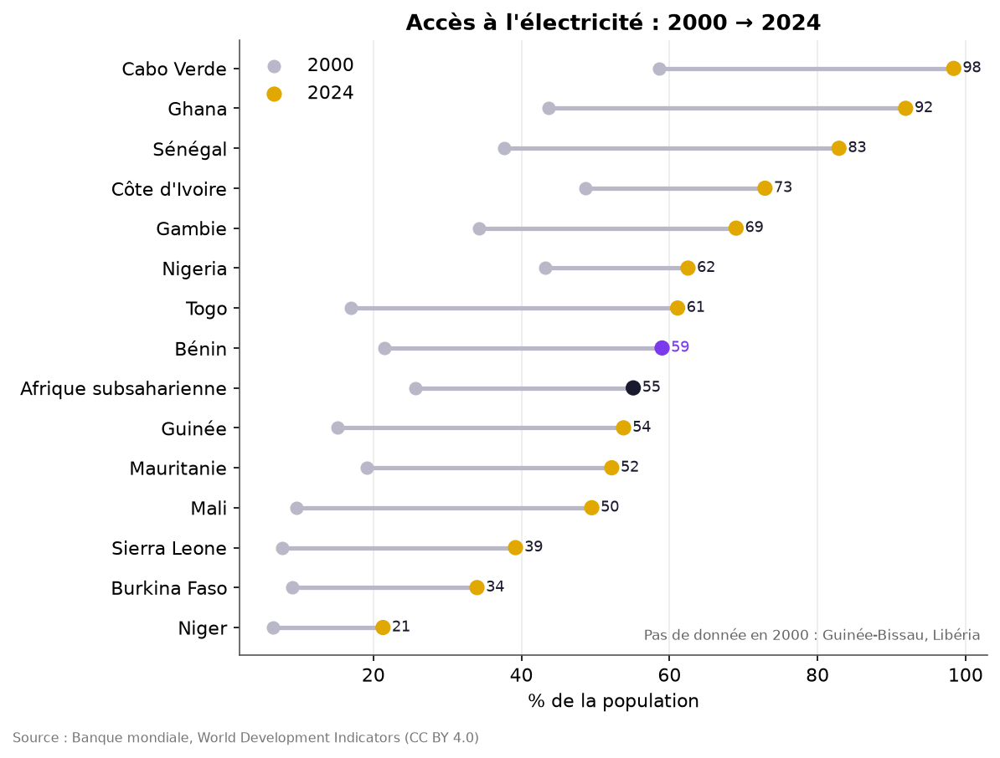
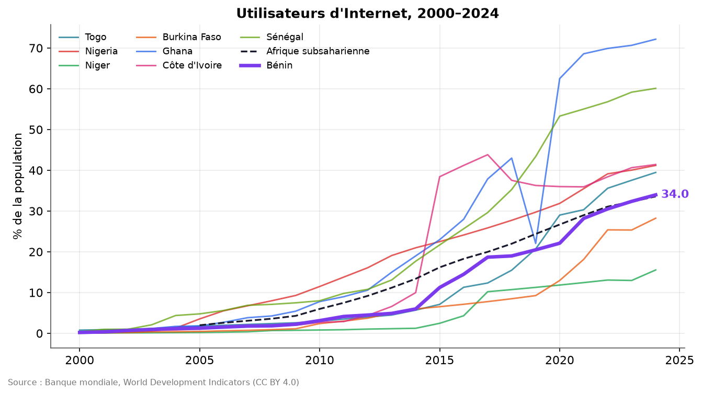
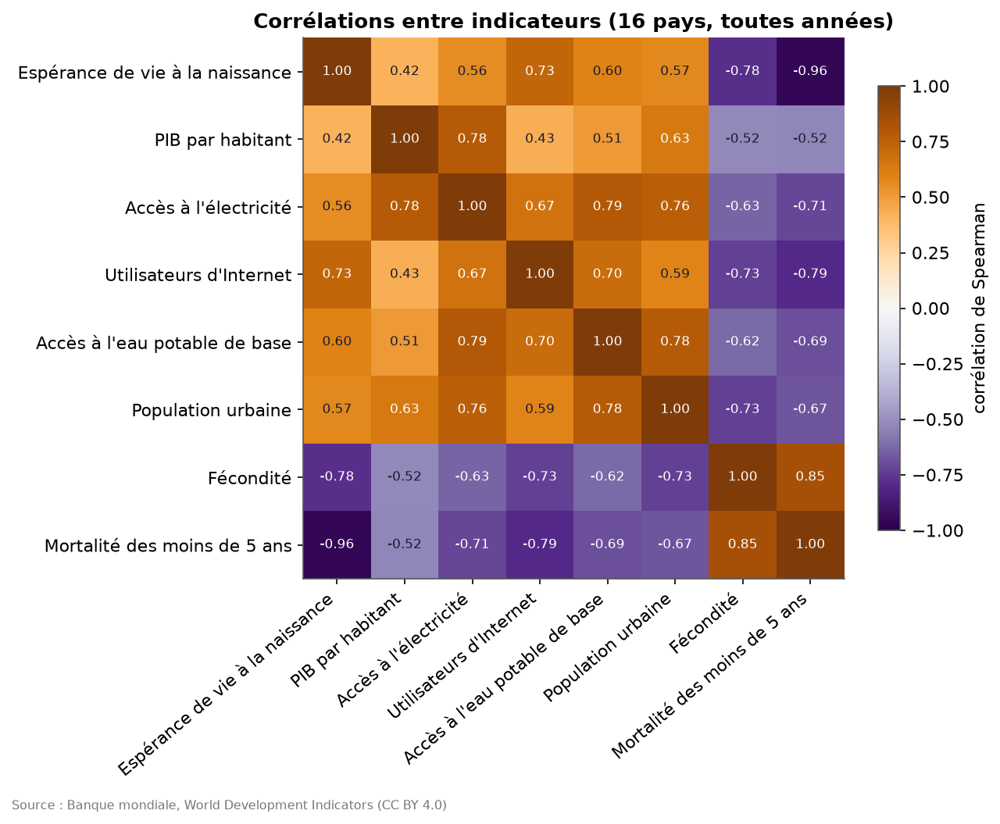
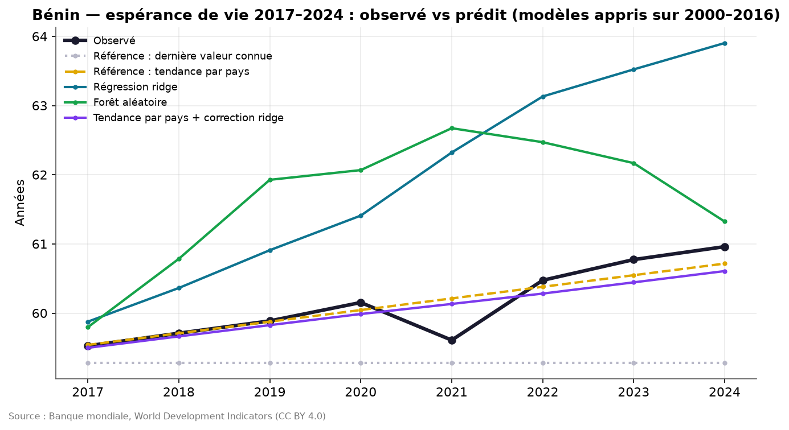
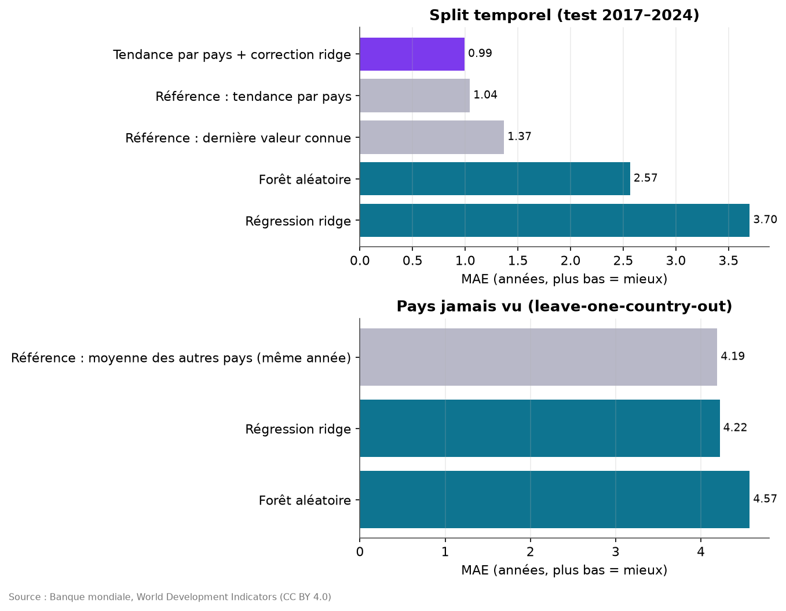

# Le Bénin et l'Afrique de l'Ouest en données (1990–2024)


Analyse exploratoire et modélisation du développement du **Bénin** et de ses **15 voisins d'Afrique de l'Ouest**
à partir des *World Development Indicators* de la Banque mondiale : santé, revenu, électricité, Internet, eau,
démographie. Projet Python reproductible (pandas, matplotlib, scikit-learn), avec tests et intégration continue.

## Contexte

On entend souvent que « l'Afrique de l'Ouest progresse », mais à quel rythme, et où se situe réellement le Bénin
par rapport au Togo, au Nigeria, au Niger, au Ghana ou au Sénégal ? Ce projet répond avec des chiffres officiels,
puis teste une question de data science plus exigeante : **des indicateurs socio-économiques permettent-ils de
prédire l'espérance de vie**, dans le temps et pour un pays jamais vu ?

## Données

| | |
| --- | --- |
| **Jeu de données** | *World Development Indicators* (WDI), Banque mondiale |
| **Version Kaggle** | [theworldbank/world-development-indicators](https://www.kaggle.com/datasets/theworldbank/world-development-indicators) |
| **Source utilisée** | API officielle de la Banque mondiale v2 — <https://api.worldbank.org/v2/> |
| **Licence** | [CC BY 4.0](https://datacatalog.worldbank.org/public-licenses) — *The World Bank: World Development Indicators* |
| **Périmètre** | 16 pays d'Afrique de l'Ouest (classification ONU) + agrégats Afrique subsaharienne et Monde, 1990–2024, 12 indicateurs |
| **Instantané** | téléchargé le 10/11/2026 (mise à jour WDI du 08/10/2026), versionné dans `data/` (≈ 350 Ko) |

**Pourquoi l'API plutôt que le fichier Kaggle ?** Le jeu Kaggle est publié par le compte officiel de la Banque
mondiale et alimenté par la même base WDI, mais son téléchargement exige un compte et un jeton Kaggle, et sa
dernière version s'arrête avant les années récentes. Le pipeline interroge donc directement la source d'origine,
ce qui donne les mêmes séries, à jour jusqu'en 2024, sans identifiants. Détails et attribution : [`data/README.md`](data/README.md).

Indicateurs : espérance de vie, PIB par habitant (USD constants 2015), croissance du PIB, population, population
urbaine, fécondité, mortalité des moins de 5 ans, accès à l'électricité, utilisateurs d'Internet, abonnements mobiles,
accès à l'eau potable de base, achèvement du primaire.

## Questions

1. Où se situe le Bénin face à ses voisins aujourd'hui (2024) ?
2. Comment l'espérance de vie, l'électricité et Internet ont-ils évolué depuis 2000 ?
3. Quels indicateurs évoluent avec l'espérance de vie ?
4. Peut-on prédire l'espérance de vie (a) des années futures, (b) d'un pays jamais vu, mieux qu'une référence simple ?

## Résultats clés

Tous les chiffres ci-dessous sont produits par le code (`reports/key_figures.json`, `reports/metrics.md`).
Rangs calculés parmi les 16 pays, du plus élevé au plus faible.

**1. Espérance de vie : le Bénin a le plus petit gain de la région depuis 2000.**
60,96 ans en 2024 (13e/16), contre une médiane ouest-africaine de 62,2 ans et 62,8 ans pour l'Afrique subsaharienne.
Le gain 2000–2024 n'est que de **+4,4 ans**, le plus faible des 16 pays (médiane +9,6 ; Sierra Leone +17,1).
Le Bénin partait pourtant d'un niveau plutôt élevé (56,6 ans en 2000) ; les pays partis de plus bas ont rattrapé leur retard.



**2. Revenu : au-dessus de la médiane, mais une croissance modeste.**
PIB par habitant de **1 325 USD** (constants 2015) en 2024, 7e/16, au-dessus de la médiane régionale (1 096 USD) mais sous
la moyenne subsaharienne (1 589 USD). Il est passé de 861 USD en 2000, soit **+1,81 % par an** en moyenne, alors que la
population a doublé (7,2 → 14,5 millions).



**3. Électricité : un rattrapage spectaculaire.**
L'accès est passé de **21,5 % à 59,0 %** de la population (+37,5 points, médiane régionale +36,1 sur 14 pays comparables),
ce qui place le Bénin 8e/16, au-dessus de l'Afrique subsaharienne (55,1 %). Les écarts restent énormes : de 21 % (Niger) à 98 % (Cabo Verde).



**4. Internet : de quasi zéro à un tiers de la population.**
0,2 % d'utilisateurs en 2000, **34,0 %** en 2024 (10e/16, médiane 38,1 %, Cabo Verde 74,7 %).



**5. L'espérance de vie suit surtout la mortalité infantile et la fécondité, moins le revenu.**
Corrélations de Spearman sur 391 observations pays-année : mortalité des moins de 5 ans **−0,96**, fécondité **−0,78**,
Internet +0,73, eau potable +0,60, urbanisation +0,57, électricité +0,56, PIB par habitant seulement **+0,42**.
Au Bénin, la mortalité des moins de 5 ans a presque été divisée par deux (135 → 74,7 ‰) et la fécondité est passée de 5,9 à 4,5
enfants par femme (4e plus élevée de la région).



### Modélisation

Cible : espérance de vie. Variables : log(PIB/hab.), électricité, eau potable, fécondité, urbanisation, Internet
(la mortalité infantile est exclue car elle entre presque mécaniquement dans le calcul de la cible).
391 observations complètes, 2000–2024. Modèle retenu sur une **validation 2013–2016** avant de toucher au test.

| Protocole | Modèle | MAE (ans) | RMSE | R² |
| --- | --- | ---: | ---: | ---: |
| Temporel, test 2017–2024 | Référence : dernière valeur connue | 1,367 | 1,697 | 0,872 |
| | Référence : tendance linéaire par pays | 1,043 | 1,398 | 0,913 |
| | Régression ridge | 3,700 | 4,394 | 0,140 |
| | Forêt aléatoire | 2,565 | 3,421 | 0,479 |
| | **Tendance par pays + correction ridge** | **0,993** | **1,342** | **0,920** |
| Pays jamais vu (16 plis) | Référence : moyenne des autres pays la même année | 4,192 | 5,489 | 0,123 |
| | Régression ridge | 4,220 | 5,432 | 0,142 |
| | Forêt aléatoire | 4,572 | 6,245 | −0,135 |

**6. Ce qui prédit le mieux l'avenir d'un pays, c'est sa propre trajectoire.**
- Les modèles « en niveau » (ridge, forêt aléatoire) font bien pire que les références simples.
- Le modèle hybride (tendance par pays + petite correction ridge) bat de peu la tendance seule (MAE 0,99 vs 1,04 an) ;
  la correction repose presque entièrement sur Internet (importance par permutation 0,014 an). **Gain marginal, non causal.**
- Pour le Bénin seul, la tendance reste meilleure (MAE 0,16 an contre 0,21 pour l'hybride). Le creux de 2021 (COVID-19) est visible.
- Pour un **pays jamais vu**, les indicateurs ne font pas mieux que la moyenne des autres pays : les écarts entre pays
  dépendent de facteurs absents des données (systèmes de santé, conflits, épidémies…).




## Structure

```
west-africa-development-analysis/
├── data/
│   ├── raw/                  # instantané WDI (format long) + metadata.json
│   ├── processed/panel.csv   # panel pays × année
│   └── README.md             # source, licence, attribution
├── notebooks/
│   ├── 01_exploration.ipynb  # tendances, comparaisons, corrélations
│   └── 02_modelisation.ipynb # splits, références, modèles, métriques
├── reports/
│   ├── figures/              # graphiques PNG
│   ├── key_figures.json      # chiffres clés
│   └── metrics.md            # tableaux de résultats
├── scripts/build_notebooks.py
├── src/
│   ├── config.py             # pays, indicateurs, chemins
│   ├── data.py               # téléchargement API + construction du panel
│   ├── analysis.py           # variations, taux de croissance, rangs, corrélations
│   ├── plots.py              # graphiques
│   ├── report.py             # chiffres clés + figures 01–05
│   └── model.py              # références, modèles, évaluations, figures 06–08
├── tests/                    # pytest (sans réseau)
└── .github/workflows/tests.yml
```

## Installation

```bash
git clone https://github.com/bienvenuessegnon/west-africa-development-analysis.git
cd west-africa-development-analysis
python -m venv .venv
source .venv/bin/activate        # Windows : .venv\Scripts\activate
pip install -r requirements.txt
```

## Utilisation

```bash
python -m src.data               # construit le panel depuis l'instantané (--refresh pour retélécharger)
python -m src.report             # chiffres clés + figures 01–05
python -m src.model              # modélisation + figures 06–08 + reports/metrics.md
python scripts/build_notebooks.py  # régénère et exécute les deux notebooks
python -m pytest -q              # tests
```

## Limites

- **Petit échantillon** : 16 pays, 391 observations complètes ; les conclusions de modélisation restent fragiles.
- **Données estimées et révisées** : beaucoup de valeurs WDI sont des estimations ou interpolations (enquêtes peu fréquentes)
  et sont révisées à chaque publication ; un `--refresh` peut modifier les chiffres.
- **Valeurs manquantes** : l'achèvement du primaire est trop lacunaire pour être utilisé ; l'électricité manque en 2000 pour
  la Guinée-Bissau et le Libéria.
- **Corrélation ≠ causalité** : les indicateurs progressent tous avec le temps ; leurs corrélations reflètent en partie cette tendance commune.
- **Nowcast plutôt que prévision** : le modèle hybride utilise les indicateurs de la même année, qui ne seraient pas connus à l'avance.
- **Choc COVID-19** : la période de test inclut 2020–2021, ce qui pénalise tous les modèles.

## Auteur

**K. O. Bienvenu ESSEGNON** — AI Engineer Aspiring & Mathématicien
[GitHub](https://github.com/bienvenuessegnon) · [LinkedIn](https://www.linkedin.com/in/bienvenuessegnon)

Code sous licence MIT. Données : Banque mondiale, World Development Indicators, CC BY 4.0. Ce projet n'est ni affilié
ni approuvé par la Banque mondiale.
